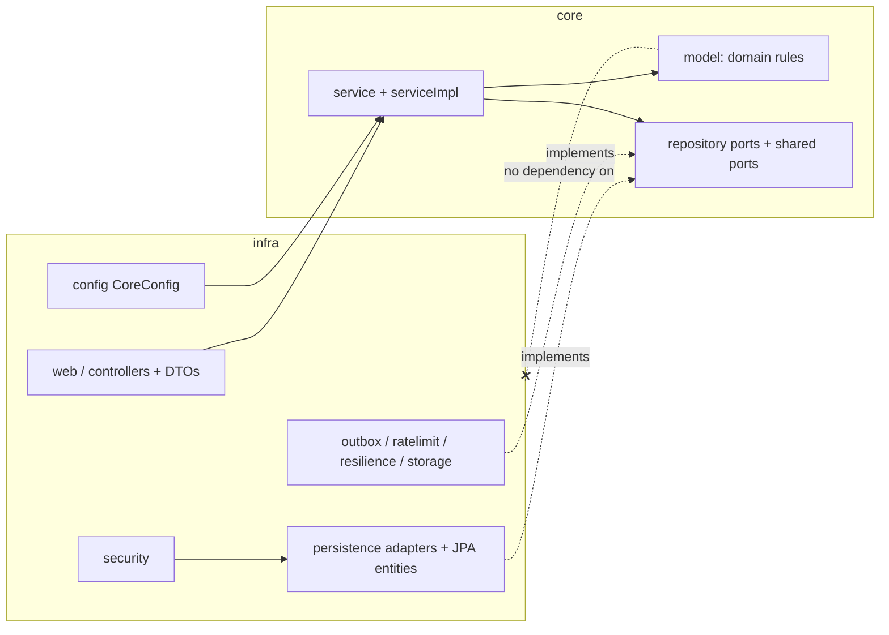
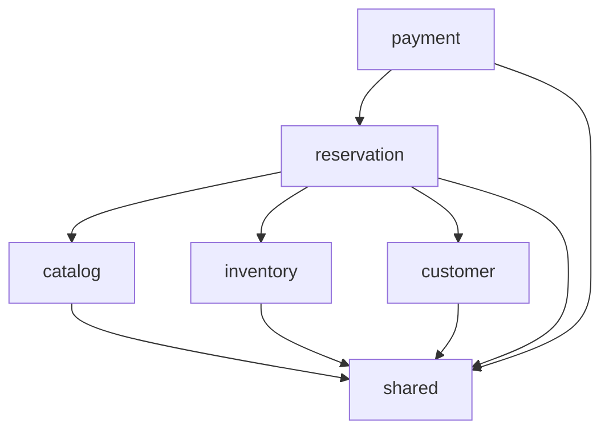

# Architecture

Pragmatic **modular monolith** with a **minimal hexagonal** split. No microservices, no message broker (a PostgreSQL outbox is enough; see ADR 0002).

## Project history
The repository started as a generated Spring Boot skeleton with a placeholder Maven group/package, an unrelated project's instructions in `CLAUDE.md`,
and an `AGENTS.md` whose generic rules were valid but whose regression section used another product's examples. All of that was verified and then replaced:
Maven `com.anadepot:ana-depot-api`, Java package `com.anadepot`, `CLAUDE.md` rewritten for Ana Dépôt, `AGENTS.md` kept (objective, persistence, working method,
scope, migrations, security, output) with Ana Dépôt invariants in the regression section. The skeleton had no datasource configuration, no migrations and no schema, so the
schema starts from scratch (a PostgreSQL server listening on the developer machine belongs to other projects and was not inspected or touched; tests use disposable
Testcontainers databases). Sibling projects: `ana-depot-web` (storefront + administration) and this `ana-depot-api`.

## Packages
```
com.anadepot
├── core                     plain Java: business rules and use cases. No Spring/JPA/Jackson/servlet/provider SDKs.
│   ├── shared               money (Money, CurrencyTotals, SupportedCurrency), LocalizedText, Actor, ports: AuditRecorder,
│   │                        DomainEventRecorder, IdempotencyService, TransactionBoundary, CorrelationContext, OperationMetrics, paging
│   ├── catalog              model (Category, AttributeDefinition, Product, ProductPrice, ProductPricing, ProductVariant, UploadIntent...),
│   │                        repository (ports), service (CatalogService, UploadService), serviceImpl
│   ├── inventory            model (InventoryItem, StockMovement), repository, service, serviceImpl
│   ├── reservation          model (Reservation aggregate, ReservationLine snapshot, Balance, StatusChange...), repository, service, serviceImpl
│   ├── customer             model, repository
│   └── payment              model (Payment, LedgerEntry), repository, service (PaymentService), serviceImpl
└── infra                    everything that touches a framework or the outside world
    ├── AnaDepotApplication  (here on purpose: component scanning covers only infra; core is wired in CoreConfig)
    ├── config               CoreConfig (the only place core meets Spring), AnaProperties (all limits), transaction boundary, metrics, correlation
    ├── persistence          audit recorder, idempotency store, InsertOnlyEntity, Json helper
    ├── catalog inventory reservation customer payment   JPA entities (package-private), Spring Data repositories, adapters, mappers, DTOs, controllers
    ├── outbox               outbox entity/recorder/dispatcher, event handlers, EventDeduplicator
    ├── resilience           RetryPolicy, RetryExecutor, Transient/PermanentFailure
    ├── ratelimit            RateLimiter (PostgreSQL counters), RateLimitFilter, ClientIpResolver
    ├── storage              upload-intent persistence, UnconfiguredObjectStorage (fail-closed default)
    ├── security             SecurityConfig, SupabaseJwtDecoders, staff directory/bootstrap, /me
    └── web                  CorrelationIdFilter, GlobalExceptionHandler (RFC 9457 problem+json)
```
Naming convention (required): `service` = interfaces, `serviceImpl` = `XxxServiceImpl`. `ArchitectureTest` fails the build if `core` imports a
framework, if a third top-level package appears, if an entity appears in `core`, or if raw JDBC/`JdbcTemplate` is used anywhere (tests included).


Dependency rule: `infra → core`, never the reverse. Core talks to the outside only through ports it owns (repositories, `ObjectStorage`,
`AuditRecorder`, `DomainEventRecorder`, `IdempotencyService`, `TransactionBoundary`...).

## Bounded contexts
| Context | Owns | Depends on |
|---|---|---|
| shared | money, localized text, actor, cross-cutting ports | — |
| catalog | categories, attribute definitions, products, variants, per-currency prices, images, upload intents | shared |
| inventory | stock position per product/variant, movements | shared |
| reservation | reservation aggregate, lines (snapshots), per-currency totals, history, notes | catalog (pricing/quote), inventory (stock), customer, shared |
| customer | guest/registered customer contact record | shared |
| payment | payments, payment ledger, reconciliation | reservation (balances), shared |



## Transactions
A use case = one database transaction opened through `TransactionBoundary` (REQUIRED, joins an outer one). Inside it: lock → rule → state change →
audit entry → outbox event. **No network call runs inside a transaction** (uploads inspect storage between two short transactions; the outbox dispatcher
delivers outside any transaction). Repository adapters are `@Transactional` so reads work without open-in-view (disabled).

## Wiring
`CoreConfig` builds `CatalogServiceImpl`, `InventoryServiceImpl`, `ReservationServiceImpl`, `PaymentServiceImpl`, `UploadServiceImpl` from the adapters
(Spring injects the ports). Replacing an adapter (e.g. a real `ObjectStorage`) is a bean definition in `infra`; core does not change.
