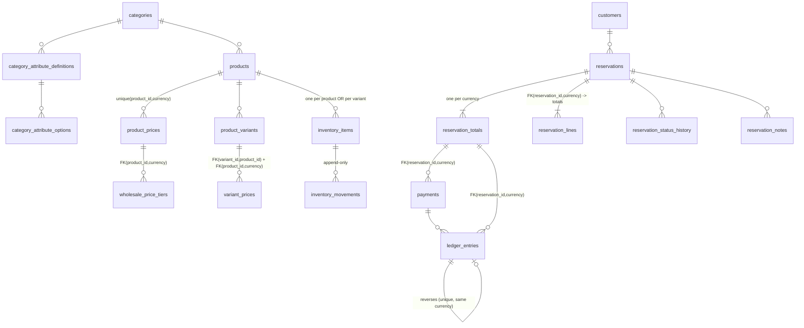

# PostgreSQL schema

PostgreSQL + Flyway (`src/main/resources/db/migration`) + Hibernate `ddl-auto=validate` (entities must match the schema; production never auto-generates DDL).
Test databases are disposable Testcontainers instances running the same migrations.

## Migrations (ordered)
| Version | File | Content |
|---|---|---|
| V1 | `V1__catalog.sql` | `currencies` (seeded HTG, USD — reference data), `categories`, `category_attribute_definitions`, `category_attribute_options`, `products`, `product_attribute_values`, `product_images`, `product_variants`, `product_variant_axis_values`, `product_prices`, `wholesale_price_tiers`, `variant_prices` |
| V2 | `V2__customers_and_inventory.sql` | `customers`, `inventory_items`, `inventory_movements`, `prevent_mutation()` trigger function |
| V3 | `V3__reservations.sql` | `reservations`, `reservation_totals`, `reservation_lines`, `reservation_status_history`, `reservation_notes` |
| V4 | `V4__payments_and_ledger.sql` | `payments`, `ledger_entries` |
| V5 | `V5__platform.sql` | `outbox_events`, `idempotency_keys`, `processed_events`, `audit_events`, `rate_limit_counters`, `upload_intents`, `staff_members` |

| V6 | `V6__store_settings.sql` | `store_settings` (key/value jsonb with optimistic `version`, `updated_by`, `updated_at`): today only the pickup configuration; no default row, so pickup is "not configured" until the owner saves it |
| V7 | `V7__catalog_search.sql` | `products.sort_name`, supporting indexes (status/created, brand, active price per currency, attribute values, inventory by product). Its `search_text` column was superseded by V8 |
| V8 | `V8__catalog_fulltext_search.sql` | `products.search_vector tsvector` + GIN index `products_search_vector_idx` (`fastupdate = off`), safe SQL backfill, drops `search_text` (docs/search.md, ADR 0015) |
| V9 | `V9__customer_accounts.sql` | drops `unique (dial_code, phone)` on `customers`; `customers_guest_phone_uq` = unique `(dial_code, phone)` **where `auth_user_id is null`** (guests only); `auth_user_id` stays unique (V2); `reservations_customer_created_idx (customer_id, created_at desc, id)` replaces `reservations_customer_idx`. Registered customers are separate records and are never merged with guests |
| V10 | `V10__data_api_lockdown.sql` | Row Level Security enabled with **no policies** on every application table; when the Supabase roles `anon`/`authenticated`/`service_role` exist: all privileges on tables, sequences and functions of `public` revoked from them (and from PUBLIC for functions), default privileges revoked. Idempotent, harmless on plain PostgreSQL. Must stay the **last** schema-security migration; new tables added by later migrations must enable RLS themselves (ADR 0013, docs/supabase-database.md) |

Note: V1, V3, V4 and V5 were corrected once before any deployment (a `varvarchar` typo made them invalid SQL, so they could not have been applied anywhere);
from the first successful application onward they are immutable.

**Conventions.** `V<n>__<description>.sql`, strictly increasing. Released migrations are immutable (never edit, rename, renumber, merge; never `flyway repair`, never disable validation);
schema changes = the next version, data-preserving. No migration invents values for existing rows (the only seed is the `currencies` reference table). Money: `numeric(19,2)`
(both launch currencies have 2 decimals; a currency with a different number of decimals needs a new migration). Currency columns: `varchar(3)` with a foreign key to `currencies`
(adding a currency = a data migration inserting a row + a `SupportedCurrency` constant). Ids are application-generated UUIDs. Localized text and snapshots are `jsonb`. Timestamps `timestamptz`.
Optimistic `version` on mutable aggregates (products, categories, reservations, inventory items).

## Relationships

The product-and-price part, in words: one `products` row; 1..N `product_prices` rows (one per currency); tiers attach to a price via the **composite** key `(product_id, currency)`;
one `inventory_items` row per product/variant (a second one is impossible: partial unique indexes) shared by all currencies.

## Constraints enforced by PostgreSQL (all attacked directly in `*ConstraintsIntegrationTest`)
* **Currency**: FK to `currencies` (unsupported currency rejected). One price row per (product, currency). Tier ⇒ price of the same currency exists. Variant price ⇒ the variant belongs to that product and the product is priced in that currency.
* **Prices**: `retail > 0`; `sale` null or `0 < sale < retail`; `min_order_quantity ≥ 1`; tier `min_quantity ≥ 2`, `unit_price > 0`; unique tier quantity per product+currency.
* **Uniqueness**: SKU unique across products and across variants; slug, category slug, reservation reference (`^ANA-[A-Z2-9]{6}$`), customer (dial code + digits-only phone), upload object key; idempotency key per (actor scope, operation, key); processed event per (consumer, event id).
* **Attributes**: only CHOICE attributes filterable/variant axis; an attribute value holds exactly one of option/text/number; an option must belong to the stated attribute (composite FK); one value per (product, attribute).
* **Product lifecycle**: a non-DRAFT product must have a SKU.
* **Inventory**: `on_hand ≥ 0`, `reserved ≥ 0`; untracked ⇒ both 0; one position per product (variant null) and per variant; a variant position's product must own the variant; `SALE` movement ⇔ has a reservation; `balance_after ≥ 0`; movements immutable (trigger).
* **Reservations**: totals one row per currency, `total > 0`, `paid ≥ 0`; line currency must have a total row (deferred composite FK); `line_total = unit_price × quantity`; `WHOLESALE ⇔ tier recorded`; `quantity > 0`; READY/COLLECTED need `ready_at`; history `(reservation, seq)` unique.
* **Payments/ledger**: payment `amount > 0`, method in (`CASH_AT_PICKUP`), currency must be one the reservation owes (composite FK); ledger `amount ≠ 0`; received ⇒ positive + payment; reversal ⇒ negative + references the entry it reverses (same currency, unique ⇒ reversed once) + payment; adjustment ⇒ reason; one receipt entry per payment; **payments, ledger, audit events and inventory movements cannot be UPDATEd or DELETEd** (`prevent_mutation` trigger).
* Deferrable (initially deferred) constraints exist where a parent and its children are inserted together (tiers/variant prices ↔ prices, reservation lines ↔ totals, replaced rows with the same natural key).

## Rules enforced in the application only (cannot be a simple constraint)
* Wholesale tier ordering/price relationships (ascending quantities, falling prices, below base price) and "tiers only when wholesale is enabled" — `ProductPrice` constructor.
* An attribute value's type matches its definition; the attribute belongs to the product's category; variant axes are category variant-axis attributes — `CatalogServiceImpl.saveProduct`.
* `reservation_totals.total_amount` = per-currency sum of the lines (domain constructor; tested). `reservation_totals.paid_amount` = ledger sum (cache; `PaymentService.reconcile`).
* A reversal's amount is the negation of the entry it reverses. A product with variants has stock per variant, not per product. Product SKU vs variant SKU cross-uniqueness.
* `inventory_items.reserved` equals the quantity held by open reservations (maintained by the use cases under lock; reconcilable, tested).

## Catalog search
`products.search_vector` (weights A names, B SKU/variant SKUs/brand/category name, C description, D attribute labels/values) is written by the catalog use cases in the transaction of every
product/category change (never by a trigger or generated column: it depends on other tables) and rebuilt by `POST /api/v1/admin/catalog/search/reindex`. See docs/search.md.

## Platform tables
`outbox_events` (ADR 0002), `idempotency_keys` (ADR 0004), `processed_events` (ADR 0006), `audit_events` (append-only audit trail), `rate_limit_counters` (ADR 0008),
`upload_intents` (ADR 0007), `staff_members` (authorization boundary, docs/auth.md).
