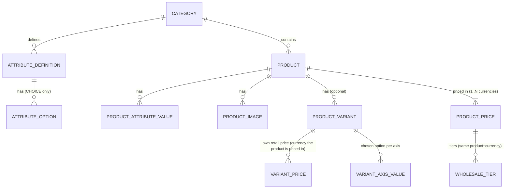
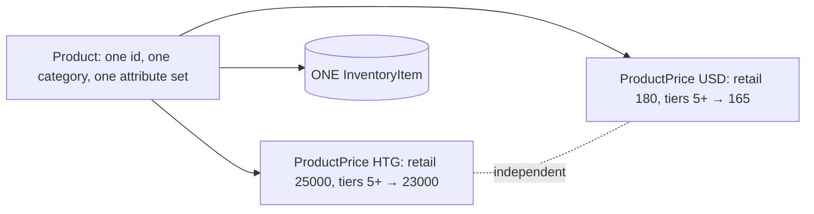

# Domain model

## Money and currency
`Money(BigDecimal amount, SupportedCurrency currency)`, immutable. `SupportedCurrency` = `HTG`, `USD` (enum name = ISO 4217 code, 2 fraction digits each).

* Never `float`/`double`. Amounts have exactly the currency's decimals; `Money.of("10.001", USD)` is **rejected** (no silent rounding). The only rounding is the
  explicit `Money.roundedFrom` (HALF_UP) used for proportional variant-tier scaling.
* `plus`, `minus`, `min`, `compareTo` between different currencies throw `CurrencyMismatchException` (`code=currency_mismatch`). `equals` is false across currencies.
* `CurrencyTotals` holds **one amount per currency** (HTG and USD side by side). There is no grand total anywhere.
* No exchange rate, no conversion operation, no inference of currency from a user's country/location. A future conversion needs an explicitly configured
  policy kept separate from the original price.
* Frontend equivalent: `Money { amount: integer minor units, currency }` (`ana-depot-web/src/lib/money.ts`, `sumByCurrency`). The backend uses major units as
  `BigDecimal` (`2500000` minor = `25000.00`); the API exposes amounts as **decimal strings** (`"25000.00"`).

## Catalog

* **Categories define attributes** (`AttributeDefinition`: key, localized label, type `CHOICE|TEXT|NUMBER`, unit, required, filterable, variant axis, order, active,
  options). Only `CHOICE` can be filterable or a variant axis. New categories/attributes need no code change.
* **Product**: one identity, category, SKU (required unless DRAFT), slug, localized name/description (`LocalizedText`: language code → text, open-ended), selling unit
  (`UNIT PAIR PACK BOX SET METER KILOGRAM`, stored as text, list undecided, **no pack/box conversions**), images (position 0 = primary), attribute values, optional
  variants, status `DRAFT|ACTIVE|INACTIVE`, timestamps. `requirePublishable(category)`: SKU, ≥1 active price, ≥1 active variant if it has variants, all required attributes.
* **Variant**: belongs to one product, own SKU, active flag, axis values (category CHOICE attributes flagged variant axis), optional own retail price per currency.

### Per-currency pricing (the key design decision — ADR 0011)
A product has **no currency**. `ProductPricing` is a set of `ProductPrice`, **at most one per currency** (HTG only, USD only, or both; a missing currency is never generated or converted).
Each `ProductPrice` = `{currency, retail, sale?, minOrderQuantity, wholesaleEnabled, tiers[], active}`. Invariants (domain + database where possible):

1. only supported currencies (enum + `currencies` FK); 2. no duplicate currency per product (`unique(product_id,currency)`); 3. one configuration per currency (`active` flag pauses a currency without deleting it);
4. tiers belong to a specific product **and** currency (composite FK); 5. tier quantity ≥ 2, strictly ascending, tier prices > 0, strictly falling, below the base price (sale if any, else retail);
6. sale > 0 and < retail; 7. every amount in the price's currency (`CurrencyMismatchException` otherwise); 8. wholesale disabled ⇒ no tiers; minimum order ≥ 1.

`ProductPrice.quote(variantRetail?, quantity)` — **same semantics as the storefront** (`snapshotFor` + `unitPriceFor`):
* the highest tier whose threshold the quantity reaches wins (`WHOLESALE`, tier recorded); otherwise `SALE` if base < retail else `RETAIL`;
* a variant **with its own price** ignores the product's sale price, uses its price as base, and scales every tier **proportionally**:
  `tier × variantRetail ÷ productRetail`, rounded HALF_UP **once** to the currency's decimals (the frontend rounds minor units with `Math.round`; identical up to float noise);
* a tier price never exceeds the base price; a variant override exists per currency and only where the product itself has a price in that currency (composite FK).

## Inventory
`InventoryItem(productId, variantId?, tracked, lowStockThreshold?, onHand, reserved)` — **one per product (or per variant), shared by every currency**.
`available = max(0, onHand − reserved)`. `reserved` = quantity held by open reservations (PENDING_REVIEW, CONFIRMED, READY_FOR_PICKUP).
* reserve (≤ available) / release (reject, cancel, expire) / hand over (collect: `onHand −= qty`, `reserved −= qty`, `SALE` movement linked to the reservation).
* manual `adjust`: `ADD`, `REDUCE`, `RECOUNT`, reason mandatory, `StockMovement` append-only with delta, balance after, reason, timestamp, who. Never touches `reserved`.
* Physical loss below `reserved` is allowed (as in the storefront): available clamps to 0 and no new reservation is accepted. No low-stock policy is invented: "low" exists only if the seller set a threshold.
* Untracked items have no quantity limit. `reserved` is a counter updated in the same transaction as the reservation change and can be reconciled with `ReservationRepository.openHeldQuantity` (tested).
* **Concurrency**: see ADR 0009 (row locks `SELECT … FOR UPDATE` taken in a stable `ItemKey` order inside the use-case transaction).

## Reservation

```mermaid
stateDiagram-v2
  [*] --> PENDING_REVIEW: submit (stock held)
  PENDING_REVIEW --> CONFIRMED: accept
  PENDING_REVIEW --> REJECTED: reject (reason; OTHER needs explanation) — stock released
  CONFIRMED --> READY_FOR_PICKUP: markReady (expiresAt only if a hold policy exists)
  READY_FOR_PICKUP --> COLLECTED: collect — requires EVERY currency paid; stock handed over
  PENDING_REVIEW --> CANCELLED: cancel (reason) — stock released
  CONFIRMED --> CANCELLED: cancel (reason)
  READY_FOR_PICKUP --> CANCELLED: cancel (reason)
  CONFIRMED --> EXPIRED: expire (system) — stock released
  READY_FOR_PICKUP --> EXPIRED: expire (system)
```

* `Reservation.submit` always yields PENDING_REVIEW/unpaid. **Prices are never supplied by the client**: `ReservationServiceImpl` calls `Product.quote(variant, currency, qty)`
  (product ACTIVE, price active in that currency, variant valid, minimum order respected) and snapshots the result.
* **Line snapshot** (`ReservationLine`): product id, variant id, product name & SKU & variant label, selling unit, quantity, currency, applied unit price, pricing kind
  (`RETAIL|SALE|WHOLESALE`), applied wholesale tier (`tierMinQuantity`), line total (= unit × qty, enforced in the domain and by a `CHECK`). Later product/price edits never change a line.
* **Totals**: `CurrencyTotals` = per-currency sum of line totals (validated against the lines in the constructor; stored in `reservation_totals`, one row per currency).
* Pickup information is snapshotted as opaque JSON (`pickup_snapshot`): pickup settings are an unbuilt context and its details are undecided.
* History (`reservation_status_history`, append-only entries with actor kind/user, reason) and notes (`INTERNAL` vs `CUSTOMER_VISIBLE`). Guests need no account (`Actor.guest()`);
  contact details are copied onto the reservation and linked to a `customers` row by phone.
* Not modelled (undecided): who may do what (roles), hold period, customer-cancellation policy.

## Payments and the ledger (ADR 0001)
Payment is a **financial record, distinct from reservation status**. `Payment` (immutable): reservation, amount **and currency**, method (`CASH_AT_PICKUP` only), received/recorded time,
recorded-by user id, reference, note.
* A payment settles **only its own currency's** balance; `balances()` = total / paid / due per currency; `paymentStatus` = PAID only if every currency is settled, PARTIAL if any
  amount was paid, else UNPAID. A huge USD payment never settles HTG (tested).
* Every money movement writes a `LedgerEntry` (signed amount, own currency): `PAYMENT_RECEIVED` (+), `PAYMENT_REVERSAL` (− of exactly one earlier entry, reason), `ADJUSTMENT` (±, reason).
  Entries are append-only (**database trigger**), carry actor, timestamp and correlation id. The paid amount cached on `reservation_totals` is **derived** and reconcilable:
  `PaymentService.reconcile` compares cache vs ledger per currency (a drift is detected in tests).
* Payments are recorded only while READY_FOR_PICKUP. **Reversal and adjustment are also limited to READY_FOR_PICKUP** (conservative; policy undecided).
* **Overpayment** is accepted (the due amount floors at 0 and the original amount is preserved) — the storefront's current behavior and an unresolved business decision; documented, not "fixed".
* Which operations write ledger entries: payment received / reversed / adjusted. **No entry** for reservation transitions, stock movements, catalog or price changes (those are audited, not financial).
* Double-entry accounting is **not introduced** (no chart of accounts, no tax rules). This is a payments journal; when accounting postings are added they must be balanced debit/credit entries.

## Mapping to the storefront (`ana-depot-web`)
| Storefront (demo) | Backend |
|---|---|
| `Pricing.currency` per product (currency chosen per product) | **replaced** by per-currency `ProductPrice` rows under one product (the confirmed requirement) |
| `Reservation.totals: Money[]` | `reservation_totals` (one row per currency) |
| `recordPayment { amount, currency }`, `balances()` | `PaymentService.record`, `Reservation.balances()` |
| `unitPriceFor`, `snapshotFor`, tier validation | `ProductPrice.quote` / constructor validation |
| stock reserved from open reservations | `inventory_items.reserved` counter (+ reconciliation) |
| `LText {fr, ht}` | `LocalizedText` (open language map, `jsonb`) |
| variant options defined per product | variants use **category** CHOICE attributes flagged variant axis (per-product ad-hoc axes are not modelled) |
| MonCash/NatCash "soon" | not modelled |

## Open business decisions
Wholesale visibility (everyone vs approved accounts); business-wide minimum order; final unit list; pack/box conversion; hold period; real pickup details; notification channel;
who may record payments and partial-payment policy; customer cancellation after ready; staff roles/permissions; legal pages; low-stock policy; **overpayment**; reversal/adjustment timing
(READY only, today); whether product-level ad-hoc variant options are needed.
